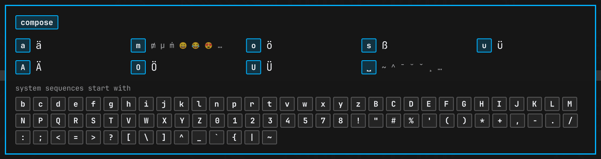
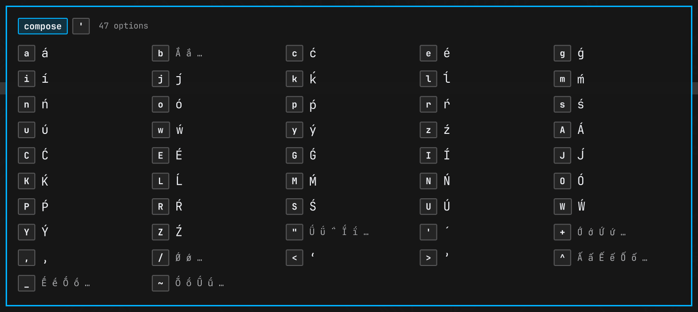

# Omacompose

A which-key style overlay for the compose key on [Omarchy](https://omarchy.org/).
Press compose (Caps Lock on Omarchy) and a small panel shows every key you can
press next and what it produces. It narrows as you type and disappears when the
sequence is done.





It doesn't replace compose. Your keys still go to the app exactly as before, and
the overlay only watches. It never takes keyboard focus or mouse input.

## Features

- **Reads your real configuration.** Every time you press compose it re-reads
  `$XCOMPOSEFILE` (or `~/.XCompose`, or your locale's table), follows every
  `include`, and expands `%L`, `%H` and `%S`. Edit the file, press compose,
  and the change is there.
- **Same rules as the real thing.** A later definition replaces an earlier one,
  including prefixes, as in libxkbcommon. If your file says
  `<Multi_key> <a> : "ä"`, the overlay shows that `a` gives `ä` instead of
  listing the locale's `a…` sequences you can no longer reach.
- **Only what you can type.** It reads the keyboard layout Hyprland is using
  and hides sequences that need keys your layout doesn't have.
- **Your sequences first.** At the start, your own and Omarchy's sequences are
  shown in full, with their `# comments` as labels. The locale's sequences are
  listed by their first key.
- **Stays out of the way.** It waits 250ms before appearing, so typing a
  sequence you know never flashes the panel. It follows your Omarchy theme and
  shows on the focused monitor.

## Install

Requires Omarchy 4 (Quickshell shell, Lua Hyprland config) with `python3` and
`xkbcli` (part of libxkbcommon, installed by default).

```sh
omarchy plugin add https://github.com/tilman-schieber/omacompose.git --enable
```

Then add this line to the end of `~/.config/hypr/hyprland.lua`, so Hyprland can
tell the overlay which keys you press after compose:

```lua
pcall(dofile, os.getenv("HOME") .. "/.config/omarchy/plugins/io.github.tilman-schieber.omacompose/hypr/omacompose.lua")
```

Hyprland reloads on save. Check with `hyprctl configerrors`.

Update with `omarchy plugin update io.github.tilman-schieber.omacompose`,
then `omarchy restart shell` (the overlay stays loaded, so hot reload doesn't
replace it).

## How it works

```
Caps Lock ─► Hyprland ──► app          (compose works as always)
               │
               └─ hypr/omacompose.lua ─► omarchy-shell omacompose update <id> <keys>
                                                    │
                       compose-table.py ─► Omacompose.qml ─► overlay
```

1. **`hypr/omacompose.lua`** binds `Multi_key` without consuming it, then
   enters an `omacompose` submap. There, every key of your layout (read from
   `xkbcli compile-keymap`) has a non-consuming bind that reports its keysym.
   Shift is resolved through the keymap, so Shift+' reports `quotedbl`.
   Escape, Backspace, Enter, Tab and the Ctrl, Alt and Super keys leave the
   submap at once, so shortcuts keep working.
2. **`compose-table.py`** parses the compose files and prints the effective
   table as JSON, with display labels from libxkbcommon. It takes about 60ms
   and runs again at the start of every sequence.
3. **`Omacompose.qml`** is an Omarchy shell panel. It works out what the keys
   typed so far lead to. When the sequence is complete, has no matches, or
   you've stopped typing for 6s, it hides and calls
   `hyprctl eval 'omacompose.reset(<id>)'` to leave the submap. The id
   keeps a late reset from ending the next sequence.

While a sequence is in progress, Hyprland only uses the submap's binds, so
global shortcuts like volume keys are inactive until it ends.

## Configuration

These properties are at the top of `Omacompose.qml`:

| Property      | Default | Meaning                                              |
|---------------|---------|------------------------------------------------------|
| `showDelay`   | `250`   | ms after compose before the overlay appears (0 = at once) |
| `idleTimeout` | `6000`  | ms without a key before the sequence is abandoned    |
| `maxCells`    | `60`    | most next-key entries shown before "+ N more"        |

## IPC

```sh
omarchy-shell omacompose sources   # compose files that were read, in order
omarchy-shell omacompose reload    # re-read them now
omarchy-shell omacompose hide      # close the overlay and leave the submap
```

## Development

```sh
python3 -m unittest discover -s tests   # compose file parser
node --test tests/                      # next-key grouping
python3 compose-table.py | jq '.sources, (.entries | length)'
```

## Uninstall

Remove the `dofile` line from `hyprland.lua`, then:

```sh
omarchy plugin remove io.github.tilman-schieber.omacompose
```

## License

[MIT](LICENSE)
